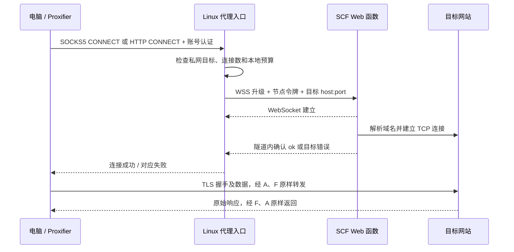

# SCF Tunnel Proxy

面向 **AI Agent 授权 Web 渗透测试、接口安全评估和自动化验证**的多区域 TCP 隧道代理。基于腾讯云 SCF Web 函数和 WSS，提供 **HTTP CONNECT、普通 HTTP 代理和带认证的 SOCKS5** 入口，也可供人工测试工具和浏览器使用。

**HTTPS 原始加密数据直接通过，不做 MITM，不生成网站证书，不要求安装私有 CA。** 同一条 TCP 连接固定使用同一条云端连接，新连接轮询选择区域；实际公网出口由腾讯云分配，不保证每次都不同。

本仓库保存一次从 HTTP 请求重放方案转向 TCP 隧道的重新实现，包含运行代码、测试、通用部署脚本和运维文件。它不是原 [CloudProxyPool](https://github.com/25smoking/CloudProxyPool) 的原样镜像，不包含其 HTTPS 解密模块。

## 适合什么场景

- 为 AI Agent 的 HTTP 客户端、浏览器和支持代理的测试工具提供统一网络出口。
- 在已授权范围内进行 Web / API 行为验证，对连接失败、区域故障与费用保护分别诊断。

- 在一台自有 Linux 服务器上暴露统一代理端口，电脑只连接这台服务器。
- 新建连接时轮询多个 SCF 区域，已有连接不随请求切换出口。
- 保持浏览器与目标网站的端到端 TLS，使用网站真实证书。
- 为个人低流量使用设置本地费用估算保护，并查看连接错误原因。

它有明确的吞吐、时长和并发边界，**不是无限带宽、无限时长、永久免费或固定 IP 的代理服务**。只应代理你有权访问的目标。

## 在 AI Agent 渗透测试工作流中的位置

```text
授权范围 / 测试任务
        ↓
AI Agent → 执行器（目标校验、任务限速、测试证据）
        ↓ HTTP CONNECT / SOCKS5
SCF Tunnel Proxy → 大陆区域 SCF WSS → 已授权目标
```

项目承担网络传输层；任务规划、漏洞判断、测试授权和证据整理由 Agent 与执行器完成。代理凭据应放在执行器的 Secret/环境变量中，不写入 Agent 提示词、聊天记录、任务报告或命令回显。

| Agent 使用方式 | 接入点 | 需要注意 |
|---|---|---|
| curl、HTTP/API 客户端 | HTTP 代理 `10800` | HTTPS 使用 CONNECT，保留网站证书验证 |
| 浏览器或由 Proxifier 接管的工具 | SOCKS5 `10801` 或 CONNECT `10800` | 应用后台连接也占用配额，内网走 Direct |
| 支持代理的 TCP 连接测试 | SOCKS5 TCP CONNECT | 工具必须支持相应代理协议；原始包、SYN 扫描和 UDP 不通过此隧道 |

**授权范围与目标限速应由执行器明确执行。** 当前代码不内置目标域名白名单或测试授权判断；私网拒绝不能替代范围控制。WebSocket 分片节奏也不等于对目标网站的 HTTP QPS 限速。

Agent 并行任务数量不等于 TCP 连接数。建议从低并发验证连接和费用开始，复用会话可减少建连开销；连接复用同时意味着不会按每个 HTTP 请求轮换出口。不要把多区域出口用于规避目标方规定的测试速率或范围。

代理为共享入口，没有按 Agent/任务隔离的配额、账本或完整测试审计。不同任务需要独立隔离时，应分别部署入口并使用独立配置与账本。

[完整 AI Agent 接入示例与执行器约束](docs/AI_AGENT.md)

## 架构与原理



电脑到入口是常规 HTTP/SOCKS5；入口到 SCF 是 WSS；SCF 到目标是 TCP。HTTPS 的 TLS 连接端点仍然是**电脑与目标网站**。WSS 是另一层传输保护，不替换网站证书。

这里的“HTTP/HTTPS 代理”通常指 HTTP CONNECT：代理地址可以是 `http://服务器:10800`，也可以用于访问 HTTPS 网站。**入口本身目前没有 TLS 服务端监听功能**，不应将它直接填成 `https://服务器:10800`。

### 为什么一条连接不能中途换 IP

目标网站的 TCP 会话依赖网络端点。连接建立后更换云端连接或出口会破坏会话，因此本实现不对已建立连接做迁移或自动重放。HTTP keep-alive、HTTP/2 会复用 TCP 连接，也就继续使用同一出口；刷新网页不一定换 IP。

增加同一区域的函数数量不等于增加独立出口 IP。本项目轮询的是函数节点，不维护可指定的固定公网 IP 清单。

### 为什么先建立 WSS，再连接目标

SCF 可能把 WebSocket 升级前的业务错误改写为 500/430“握手失败”。如果据此暂停整个区域，一个无法连接的目标就会影响其他网站。

当前协议使用 `X-Tunnel-Protocol: 2`：先完成认证 WSS，再在隧道内发送 `{"ok":true}` 或目标错误。**目标失败与节点故障分开统计**；同一失败目标短暂退避，不暂停整个区域。详见 [协议与故障机制](docs/ARCHITECTURE.md)。

## 当前默认限制

| 项目 | 默认值 / 行为 |
|---|---|
| HTTP / CONNECT | `10800`，必须账号认证 |
| SOCKS5 | `10801`，必须用户名/密码认证 |
| 监控 | `127.0.0.1:8081`，仅本机 |
| 同时建连或活跃隧道 | 32，可配置 1–64；突发最多排队 5 秒 |
| 单连接最长时长 | 7200 秒（2 小时） |
| 空闲关闭 | 120 秒（2 分钟） |
| 单连接累计流量 | 上下行合计 128 MiB |
| 数据分片与节奏 | 16 KiB，写入间隔至少 150ms；单方向约 100 KiB/s |
| 新连接故障切换 | 最多尝试 2 个不同区域；成功后不迁移连接 |
| 区域冷却 | 节点故障连续 3 次，冷却 30 秒 |
| 失败目标退避 | 两次尝试均为目标错误时，按地址退避 15 秒 |
| 私网 / 回环目标 | 拒绝；应在电脑上配置 Direct |
| UDP | 不支持 SOCKS5 UDP ASSOCIATE；不支持 QUIC 等 UDP 流量 |

时长、流量和平台限制仍会断开连接，客户端需要重连；进程自动恢复也不能无损恢复原 TCP 会话。速度还取决于网络、冷启动、SCF 配额和目标网站。

## 快速开始

### 1. 准备环境并构建

需要 Go **1.26.5 或更高兼容版本**、Python **3.11+**。服务端安装脚本面向有 systemd 的 **Linux amd64**，依赖 `python3`、`logrotate` 及常规系统工具。推荐使用仍受支持的 Ubuntu LTS。

```bash
git clone https://github.com/f0raway/scf-tunnel-proxy.git
cd scf-tunnel-proxy
bash ops/build.sh
```

生成 `dist/scf-tunnel-linux-amd64`。同一个程序通过 `-node` 运行云函数，通过 `-config` 运行入口代理。无需在 SCF 中安装 Go 或 Python 第三方库。

### 2. 准备腾讯云部署配置

```bash
python3 -m venv .venv
.venv/bin/pip install -r deploy/requirements.txt
cp config/deploy.toml.example config/deploy.toml
chmod 600 config/deploy.toml
```

编辑 `config/deploy.toml`。默认区域为上海、广州、北京、成都、南京，不包含境外区域。区域是否对账号开放、是否有配额，以腾讯云实时结果为准。

通过环境变量提供凭据，或在**本地私有配置**的 `[tencent]` 段填写。不要提交真实值。以下交互读取不会把密钥写进命令历史：

```bash
read -r -p 'Tencent SecretId: ' TENCENTCLOUD_SECRET_ID
read -r -s -p 'Tencent SecretKey: ' TENCENTCLOUD_SECRET_KEY
printf '\n'
export TENCENTCLOUD_SECRET_ID TENCENTCLOUD_SECRET_KEY
```

临时凭据还应设置 `TENCENTCLOUD_SESSION_TOKEN`。账号需要开通 SCF 并具备相应函数创建、查询、代码更新和函数 URL 触发器管理权限。

先预览，不创建资源、不写令牌、不调用云 API：

```bash
.venv/bin/python deploy/deploy.py --dry-run
```

### 3. 部署云函数

**下一条命令会创建实际腾讯云资源，运行和出网可能产生费用。**

```bash
.venv/bin/python deploy/deploy.py
```

部署工具：

1. 打包 Linux 程序和可执行 `scf_bootstrap`。
2. 创建 128MB、7200 秒超时、120 秒空闲超时的 WebSocket Web 函数。
3. 使用 Python3.9 作为平台基础运行环境，通过启动脚本执行静态 Go 程序并监听 `9000`。
4. 创建函数 URL，生成独立节点访问令牌；不启用固定出口 IP、NAT 网关或预置并发。
5. 保存节点清单与代理配置；只打印区域状态，不打印密钥、令牌或密码。

默认私有输出：

```text
runtime/deploy/node-token                 # 节点令牌，必须保留
runtime/deploy/deployment-results.json    # 节点清单 / 部署错误
runtime/agent.json                       # 随机代理密码、节点令牌与运行配置
```

这些文件权限为 `600`，已被 Git 忽略。部分区域失败时保留诊断结果，**不覆盖已有代理配置**；已创建的云资源不会自动删除。

部署成功只表示资源创建成功，**还需实际转发验证**，不能把控制台 Active 等同于业务可用。

### 4. 在 Linux 入口服务器安装

将二进制、`ops/` 和私有 `runtime/agent.json` 安全复制到入口服务器。如果在入口服务器上完成上述步骤，可以直接执行：

```bash
sudo bash ops/install.sh dist/scf-tunnel-linux-amd64 runtime/agent.json
sudo systemctl status scf-tunnel-proxy --no-pager
```

默认监听所有网卡的两个代理端口。安装脚本**不更改防火墙**，请按实际需要只向可信内网 / VPN / 指定客户端开放 `10800`、`10801`，不要公开监控端口。

脚本安装独立低权限用户、开机自启、异常重启、每两分钟本地健康检查、日志轮转和内存限制。代理进程不需要腾讯云管理密钥。具体见 [运维说明](docs/OPERATIONS.md)。

已有运行环境请先阅读 [现有部署保存与迁移](docs/EXISTING_DEPLOYMENT.md)，不要让两个服务争用端口或同时写一个费用账本。

## 使用方法

从私有 `runtime/agent.json` 或 `/etc/scf-tunnel-proxy/agent.json` 读取 `user`、`password`。**代理密码和腾讯云密钥是两套不同的凭据。**

以下使用文档示例 IP `203.0.113.10`，请替换成实际入口服务器。交互读取密码后测试，不需要 `-k` 或 `--cacert`：

```bash
read -r -p 'Proxy username: ' PROXY_USER
read -r -s -p 'Proxy password: ' PROXY_PASSWORD
printf '\n'

curl --noproxy '' --proxy-user "$PROXY_USER:$PROXY_PASSWORD" \
  -x http://203.0.113.10:10800 http://myip.ipip.net

curl --noproxy '' --proxy-user "$PROXY_USER:$PROXY_PASSWORD" \
  -x http://203.0.113.10:10800 https://myip.ipip.net

curl --noproxy '' --proxy-user "$PROXY_USER:$PROXY_PASSWORD" \
  -x socks5h://203.0.113.10:10801 https://myip.ipip.net
```

`SOCKS5h` 将域名交给云端解析；客户端也可发送目标 IP。HTTPS 应看到目标网站真实证书。

### Proxifier

在 `Profile → Proxy Servers` 添加：

- Address：入口服务器 IP；Port：`10801`；Protocol：`SOCKS Version 5`。
- 启用 `Authentication`，填写代理账号密码，然后运行 `Check`。
- 若使用 `10800`，Proxifier 的协议应选 **HTTPS（CONNECT）**，不是只支持普通 HTTP 的选项。
- 使用 Proxifier 统一接管时，应用内不要再配置同一个代理，避免重复代理。

在 `Profile → Proxification Rules` 添加“内网直连”，放在代理规则前：

```text
Applications: Any
Target hosts: 192.168.0.0/16; 10.0.0.0/8; 172.16.0.0/12
Target ports: Any
Action: Direct
```

保留 Localhost 直连规则。云函数无法替电脑访问电脑所在的内网，私网目标显示不可达不等于代理服务离线。[官方代理设置](https://www.proxifier.com/docs/win-v4/proxy.html) · [官方规则说明](https://www.proxifier.com/docs/win-v4/rules.html)

## 费用保护

默认本地月阈值为 **8 元**，可作为 10 元目标预算的余量策略；**它不是腾讯云账单的精确封顶，也不保证长期免费**。

- 本地模型使用 128MB、`0.00011108 元/GB·秒`、`0.0133 元/万次`、`0.80 元/GB` 的参考价格。
- 活跃隧道的计算参考成本约 **0.05 元/连接小时**，流量、初始化及其他适用费用另计。
- 初始只预留约 30 秒计算和 256 KiB 流量；数据传输及每 5 秒检查推动小额补足。
- 预留接近耗尽且无法补足时停止该隧道；余额不足也拒绝新连接。费用账本采用文件持久保存，正常退出会结算。
- 自然月按北京时间切换；跨月活跃连接保守继续计入估算。不要通过删除账本“恢复额度”。

估算含保守流量系数，未接入实时云账单；不涵盖账号其他服务、绕过入口直接访问云 URL 的请求、全部日志费用等。价格、折扣、免费试用和计量以腾讯云实际账户为准。部署脚本固定 128MB，不能随意提高云函数内存而继续使用原费用模型。

[官方定价](https://cloud.tencent.com.cn/document/product/583/12281) · [免费试用](https://cloud.tencent.com/document/product/583/12282)

## 监控、日志与排查

```bash
curl -s http://127.0.0.1:8081/api/stats
sudo tail -100 /var/log/scf-tunnel-proxy/service.log
sudo systemctl status scf-tunnel-proxy --no-pager
```

监控显示区域状态、节点错误和目标错误、活跃/正在建连数量、预算/并发/私网拒绝、目标退避计数及本地费用估算。

需要在电脑查看面板时使用 SSH 隧道：

```bash
ssh -L 18081:127.0.0.1:8081 your-user@your-server
```

随后访问 `http://127.0.0.1:18081`。[错误码与排查步骤](docs/TROUBLESHOOTING.md)

## 开发与验证

```bash
go test -race -timeout 90s ./...
go vet ./...
python3 -m unittest discover -s deploy -p 'test_*.py' -v
bash -n ops/build.sh ops/install.sh
bash ops/build.sh
```

Go 测试覆盖 TLS 证书透传与连接复用、SOCKS5 认证、二进制流与半关闭、目标错误分类、私网拒绝、失败目标退避、账本持久化/跨月、滚动预算及正常停止结算。Python 测试覆盖打包格式/可执行权限、私有文件权限、配置生成与升级保留。

此次实现的现场版本验证过五个大陆区域、连续网页请求、混入错误目标的并发以及 32 条同时 TCP 连接，并得到用户 Proxifier Checker 通过的反馈。这是当时环境的证据，**不能代表所有账号、目标或网络条件均已验证**。仓库通用安装脚本仍需在自己的目标系统验收。

## 文件结构

```text
agent.go             入口代理、认证、区域调度、故障分类与退出结算
node.go              SCF WSS 服务、目标 DNS/TCP 连接和状态确认
stream.go            字节流封装、分片、速率、半关闭和时长/流量限制
meter.go             小额滚动预留及持久费用估算
main.go              同一程序的入口 / 云节点两种模式
tunnel_test.go       核心回归与并发测试
config/*.example     无真实凭据的配置模板
deploy/              腾讯云资源创建和代码更新工具
ops/                 构建、systemd 安装、本地健康检查
docs/                机制、运维、排查与旧部署迁移说明
```

## 安全边界与依赖

公开前已检查完整 Git 历史、当前修改和自动检查日志；检查范围与后续维护方法见 [敏感信息检查说明](docs/SECURITY.md)。

入口 HTTP Basic / SOCKS5 用户名密码本身不加密，应使用可信内网或 VPN。HTTPS 内容仍由客户端与网站 TLS 保护；普通 HTTP 的明文内容不具备这种保护。入口与云节点通过正常校验服务证书的 WSS 连接。

函数 URL 使用 `AuthType=NONE`，应用层另校验随机节点令牌；未授权请求仍可能触发平台调用计费。不要公布节点 URL 和令牌，定期核对云账单。代码不抓取或保存 HTTPS 正文；错误日志会包含目标主机/端口等连接元数据。

依赖为 Gorilla WebSocket、go-socks5 和 Go x/net，相关许可证见 [THIRD_PARTY_NOTICES](THIRD_PARTY_NOTICES.md)。仓库暂未选择原创代码的开源许可证。

## 官方参考

- [SCF WebSocket 协议支持与平台限制](https://cloud.tencent.com/document/product/583/63406/)
- [创建 SCF 函数](https://cloud.tencent.com/document/api/583/18586)
- [SCF 函数网络与出口模式](https://cloud.tencent.com/document/product/583/123457)
